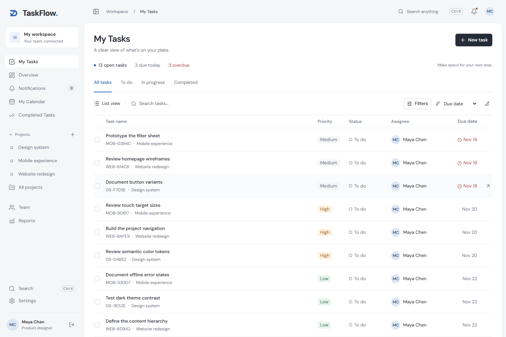
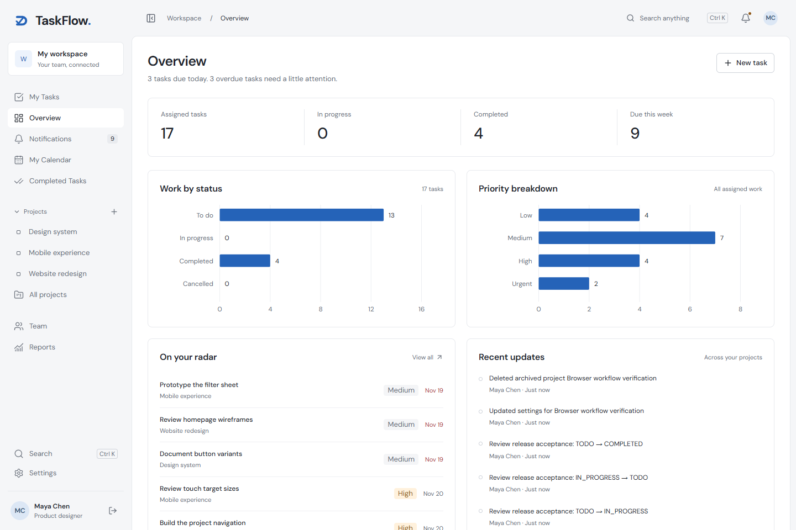
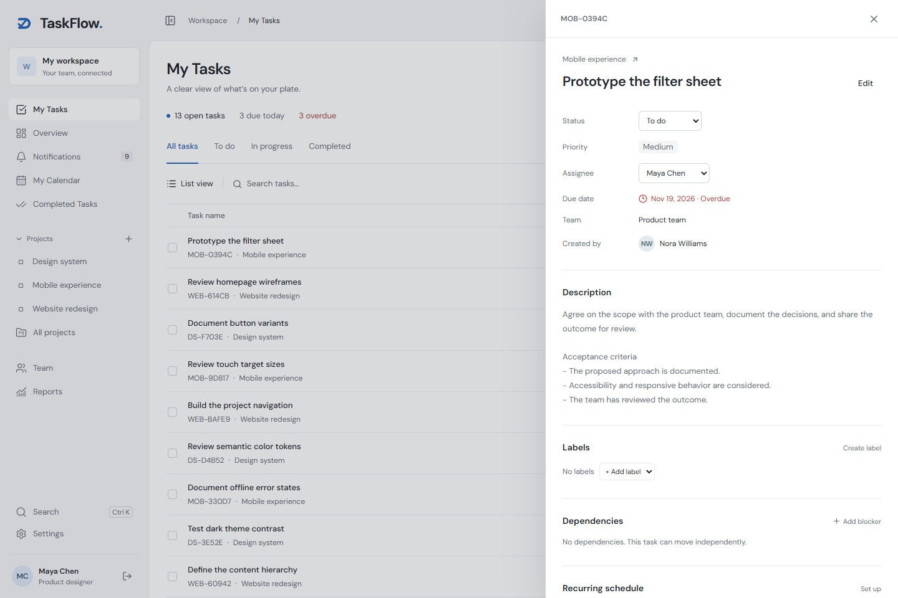
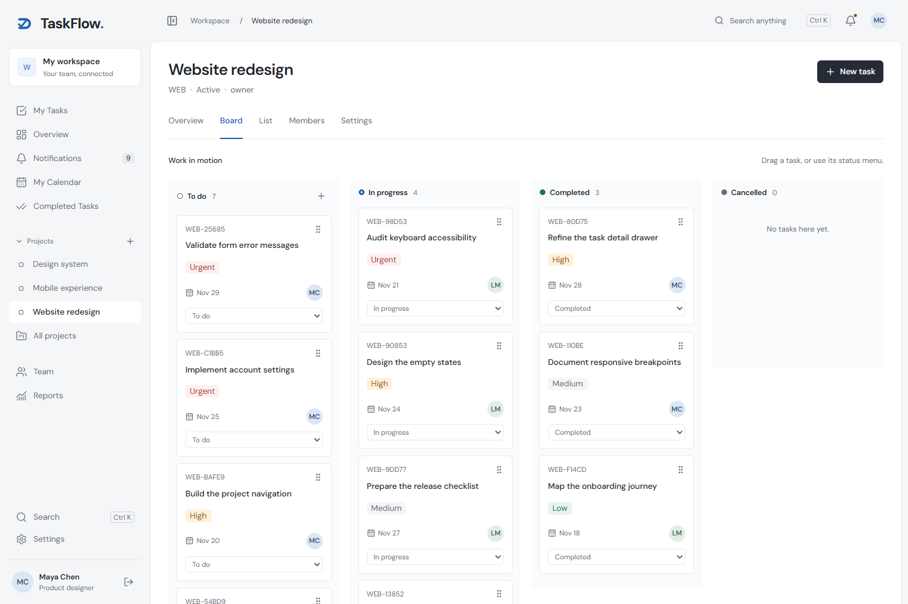
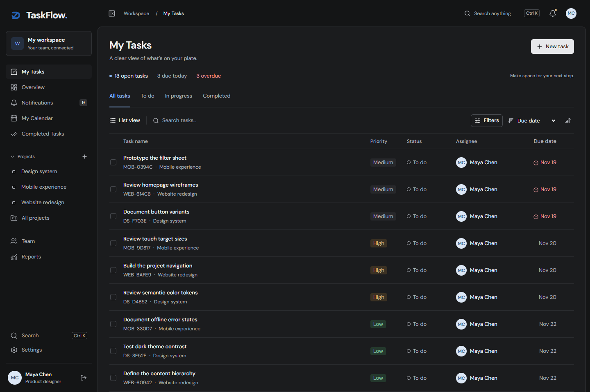

# TaskFlow

A permission-aware workspace for projects, teams and everyday work. TaskFlow pairs a Java 21 / Spring Boot API with a React interface, PostgreSQL persistence, and a consistent light and dark design.



## What it does

- **Work management:** project lifecycle, memberships, ownership transfer, team scopes, task assignment, optimistic concurrency, deadlines, server-side search/filtering/pagination, calendar, and a draggable Kanban board.
- **Collaboration:** comments and moderation, project labels, dependency cycle prevention, recurring work, persistent notifications, activity history, and permission-checked file uploads/downloads.
- **Identity:** registration, BCrypt password hashing, short-lived JWTs, rotating HttpOnly refresh cookies, account deactivation, password changes and email recovery.
- **Oversight:** real database-backed personal/project reports, admin user management and audit logs.
- **Interface:** right-side task drawer, accessible controls, responsive navigation, validation, loading/empty/error states and saved theme preference.

## Start with Docker

Requires Docker Desktop/Engine with Compose. Run commands from the repository root. The Windows setup helper preserves an existing `.env` and generates random secrets without printing them:

```powershell
./scripts/setup.ps1 -Seed
docker compose --profile full up -d --build --wait
```

The first build downloads Java, Node and Maven dependencies and can take several minutes. Omit `-Seed` for an empty workspace. On macOS/Linux without PowerShell, copy `.env.example` to `.env`, replace every secret placeholder with a random value, and explicitly enable `SEED_ENABLED=true` only for development. A suitable JWT secret is the base64 encoding of at least 32 random bytes, for example `openssl rand -base64 48`.

| Service | Local address |
| --- | --- |
| Application | http://localhost:5173 |
| API | http://localhost:8080/api/v1 |
| Swagger UI | http://localhost:8080/docs |
| API health | http://localhost:8080/actuator/health |
| Mailpit inbox | http://localhost:8025 |
| PostgreSQL | localhost:5436 |

All published ports bind to loopback. The web container serves the production build and proxies `/api/` to Spring Boot, preserving same-origin cookies. PostgreSQL and attachments use named volumes. `docker compose --profile full down` stops/removes the containers while retaining data. Do not add `-v` unless you deliberately want to erase the database and uploads.

If local Java/Vite development processes already occupy the ports, stop those TaskFlow processes with `./scripts/stop-dev.ps1` first. It verifies recorded process identities and leaves unrelated services alone.

## Development accounts

Seeding is opt-in and runs only when the user table is empty. These are real development records in PostgreSQL, never frontend mocks. Every seed account uses the generated **`SEED_PASSWORD` in your local `.env`**. Keep that file private.

| Email | Role in the Website redesign project |
| --- | --- |
| maya@taskflow.local | Owner (system USER) |
| nora@taskflow.local | Manager |
| eli@taskflow.local | Team lead |
| leo@taskflow.local | Member |
| iris@taskflow.local | Viewer |
| admin@taskflow.local | System administrator |

Example projects are Website redesign, Mobile experience and Design system. Replace these records for actual use; turn off seeding outside development. Newly registered users start with no project memberships. Registration never grants ADMIN.

## Run from source

Requires Java 21, Maven 3.9+, Node 24, npm and Docker. A project-local JDK in `.tools/jdk-21*` is supported; the repository does not require changing global Java settings.

```powershell
./scripts/setup.ps1 -Seed
. ./scripts/env.ps1
docker compose up -d db mail
mvn -gs scripts/maven-settings.xml -s scripts/maven-settings.xml -f backend/pom.xml -B -ntp package
npm --prefix frontend ci
./scripts/restart-api.ps1
npm --prefix frontend run dev
```

Keep Vite running in that terminal. The restart helper runs a copy of the API JAR under `.runtime` so Windows does not lock Maven's build output. Logs are in `.runtime/api.stdout.log` and `.runtime/api.stderr.log`. For an existing Java 21 shell, the equivalent API command is `java -jar backend/target/taskflow-api-1.0.0-SNAPSHOT.jar` after loading environment variables. The Maven settings files neutralize obsolete machine-level HTTP mirrors and use Maven Central over HTTPS.

## Configuration

See `.env.example`. No actual passwords or signing secrets belong in Git.

| Variable | Purpose |
| --- | --- |
| POSTGRES_DB / POSTGRES_USER / POSTGRES_PASSWORD | Database identity and secret |
| DATABASE_PORT | Host database port (default 5436) |
| DATABASE_URL | JDBC URL override for source-based API execution |
| JWT_SECRET | Base64 encoding of 32+ random bytes |
| API_PORT / WEB_PORT | Host ports (8080 / 5173) |
| APP_URL | Browser origin used in password-reset links |
| CORS_ORIGINS | Exact comma-separated browser origins |
| COOKIE_SECURE | Set true behind HTTPS; false only for local HTTP |
| APP_ZONE | Workspace date/deadline timezone |
| SEED_ENABLED / SEED_PASSWORD | Development-only empty-database seed |
| MAIL_HOST / MAIL_PORT / MAIL_FROM | SMTP configuration for local API execution |
| MAIL_USERNAME / MAIL_PASSWORD / MAIL_AUTH / MAIL_TLS | Optional authenticated SMTP settings |
| UPLOAD_PATH | Source-based upload root; Docker uses `/app/uploads` |

When changing the web port, also set `APP_URL` and `CORS_ORIGINS` to the matching browser origin. Compose points mail at Mailpit by default; configure a real SMTP provider for a public deployment.

## Architecture and data model

```text
React / TypeScript / React Query
             │ JSON + bearer JWT; refresh cookie
             ▼
Spring MVC controllers → DTO validation → transactional services
                                            │
                                  PermissionService
                                            │
                                  JPA repositories
                                            ▼
                               PostgreSQL + Flyway
                     Local attachment volume / SMTP delivery
```

The API is a modular monolith organized by domain (`auth`, `user`, `project`, `team`, `task`, `collaboration`, `attachment`, `notification`, `report`, `activity`). Controllers handle transport; services enforce authorization and business rules. No JPA entity is exposed as an API response. See [architecture](docs/architecture.md) and [security](docs/security.md) for the decisions and tradeoffs.

Users join projects through `project_members` and project teams through `team_members`. Tasks belong to a project and optionally a team/assignee. Comments, attachment metadata, labels and directed dependency edges relate to tasks. Recurrence rules generate tasks with a unique occurrence key. Notifications belong to recipients. Audit entries preserve a snapshot of the actor and action even when project data is deleted. Refresh/reset tokens are hashed at rest.

Flyway V1 defines the core model; V2 adds collaboration; V3 adds attachment metadata. Foreign keys, unique constraints, partial indexes, row locks and optimistic versions protect important invariants. Hibernate validates the schema and never creates production tables automatically.

### Permission highlights

- Owners manage the project and transfer ownership. Managers manage ordinary memberships and work but cannot modify the owner or peer managers.
- Team leads mutate/assign work only within their team. Assignees must be active, non-viewer members of the project and, when applicable, the task's team.
- Members edit their assigned tasks; self-assignment and task creation follow project policy. Assigning other people is off by default.
- Viewers are read-only. Admin overrides are explicit and audited.
- UI capabilities mirror these rules; backend services enforce them on every request.

### Attachments

Each task accepts up to 50 files, each 1 byte–10 MB: PNG, JPEG, PDF, UTF-8 TXT/Markdown/CSV. The server validates extensions and content, generates storage keys, confines paths and forces authorized downloads as attachments. This is format validation, not antivirus scanning. Files are removed after committed attachment/task/project deletions; rolled-back uploads are cleaned up. A process crash can leave orphan files, so production operations need reconciliation and disk monitoring.

## Tests and quality checks

```powershell
. ./scripts/env.ps1
mvn -gs scripts/maven-settings.xml -s scripts/maven-settings.xml -f backend/pom.xml -B -ntp spotless:check verify
npm --prefix frontend run format:check
npm --prefix frontend test
npm --prefix frontend run build
npm --prefix frontend run test:e2e
```

Backend integration tests start a disposable PostgreSQL container with Testcontainers and exercise real HTTP requests, migrations, authorization, sessions, CRUD, collaboration, recurrence, upload validation and file cleanup. Unit tests cover permission decisions, recurrence anchors, request guards and file formats. Frontend unit tests cover token refresh, structured errors and multipart requests. Playwright tests use the running real stack, exercise persisted workflows, and remove the temporary projects they create. They require development seeding and the local `SEED_PASSWORD`. Locally they use installed Microsoft Edge; CI installs Chromium.

Verified locally on November 20, 2026: **25 backend tests, 5 frontend unit tests and 6 Docker-backed browser tests pass**, including automated accessibility checks on key screens. Browser recovery tests deactivate the test accounts they create. No remote CI execution is claimed.

Formatting: `mvn -f backend/pom.xml spotless:apply` and `npm --prefix frontend run format`. CI checks backend/tests/format, frontend/tests/build/format and the Docker-backed browser workflow. CI configuration is included; a remote GitHub run requires pushing this repository.

## Screenshots and verification

| Workspace | Detail and theme |
| --- | --- |
|  |  |
|  |  |

The supplied image in `insp/` is the visual reference. Screenshots show seeded database records. [Work log](docs/work-log.md) records the verification performed; [design review](docs/design-review.md) records responsive inspection and remaining tradeoffs.

## Deployment boundaries

The Compose setup is a verified local development/portfolio deployment, not a managed production service. Before public exposure, configure HTTPS, new secrets, secure cookies, production SMTP, backups for both database and files, shared gateway rate limits, disk quotas and monitoring. Per-process throttling is not a distributed rate limiter. Mail delivery is asynchronous but not durable. Notifications poll; there is no realtime push transport. Reports are designed for moderate workspaces rather than warehouse-scale analytics. File malware scanning, object storage, SSO/MFA and email verification are outside this implementation. See [security](docs/security.md).
